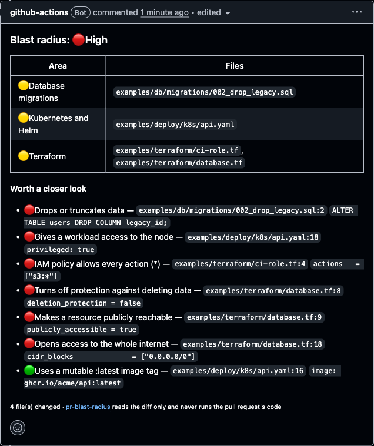

# pr-blast-radius

[](https://github.com/OTA-EITA/pr-blast-radius/actions/workflows/ci.yml)
[](https://securityscorecards.dev/viewer/?uri=github.com/OTA-EITA/pr-blast-radius)

**Know what a pull request can break before you approve it.**

A GitHub Action that reads a pull request's diff and tells the reviewer, in one comment, which parts of production it touches — Terraform, Kubernetes, CI workflows, database migrations, access rules — and points at the lines that deserve a second look: IAM wildcards, `0.0.0.0/0`, deletion protection turned off, privileged containers, `pull_request_target`, destructive SQL. It labels the PR `risk:low`, `risk:medium` or `risk:high`, so risky changes can require an extra reviewer.



👉 See it live on [the demo pull request](https://github.com/OTA-EITA/pr-blast-radius/pull/1).

## Usage

```yaml
# .github/workflows/blast-radius.yml
name: blast-radius
on:
  pull_request:

permissions: {}

jobs:
  blast-radius:
    runs-on: ubuntu-latest
    permissions:
      pull-requests: write
    steps:
      - uses: OTA-EITA/pr-blast-radius@v0.2.0 # pin to a commit SHA in real use
```

That's it: no checkout, no build, no dependencies to install.

| Input          | Default        |                                                                       |
| -------------- | -------------- | --------------------------------------------------------------------- |
| `token`        | `github.token` | Reads the PR files, writes the comment and label                      |
| `comment`      | `true`         | Create or update one comment on the PR                                |
| `label`        | `true`         | Set `risk:low` / `risk:medium` / `risk:high` and remove the other two |
| `label-prefix` | `risk:`        | Use your own label family                                             |
| `fail-on`      | `none`         | Fail the check at this risk or above (`high`, `medium`, `low`)        |
| `ignore-paths` |                | Globs to leave out, one per line or comma separated (see below)       |

Outputs: `risk`, `areas` (comma separated) and `findings` (count), for example to request a review from a platform team when `risk == 'high'`.

`ignore-paths` keeps test fixtures, examples or vendored code from raising false alarms:

```yaml
- uses: OTA-EITA/pr-blast-radius@v0.2.0
  with:
    ignore-paths: |
      test/fixtures/**
      vendor/
      *.snap
```

`*` stays within a directory, `**` spans directories, a pattern without a slash matches the file name anywhere, and a trailing slash means everything under that directory. A file moved out of an ignored path is still checked, and the comment says how many files were ignored.

## What it looks for

**Areas** (the table in the comment): possible secret files (`.env`, `*.pem`, `*.key`), CI/CD workflows and actions, `CODEOWNERS`, Terraform, CloudFormation / SAM / Serverless templates (`template.yaml`, `serverless.yml`, `samconfig.toml`, `cloudformation/`, `*.cfn.yaml`), Kubernetes manifests / Helm / Kustomize, database migrations, Dockerfiles and compose files, dependency manifests, lockfiles and Dependabot / Renovate configuration.

**Changes worth a closer look**, matched on the added (or removed) lines with their line numbers:

| Risk | Change                                                                                                                                                                                               |
| ---- | ---------------------------------------------------------------------------------------------------------------------------------------------------------------------------------------------------- |
| 🔴   | IAM `*` actions or principals, administrator roles (`AdministratorAccess`, `roles/owner`, `cluster-admin`)                                                                                           |
| 🔴   | `0.0.0.0/0` / `::/0`, publicly accessible databases, public S3 ACLs and S3 public access block flags set to `false` (Terraform and CloudFormation), GCP `allUsers` / `allAuthenticatedUsers` members |
| 🔴   | `deletion_protection` / `prevent_destroy` / `DeletionProtection` turned off or removed, `DeletionPolicy: Retain` removed, `skip_final_snapshot`, `force_destroy`                                     |
| 🔴   | `DROP TABLE`, `DROP COLUMN`, `TRUNCATE` in migrations                                                                                                                                                |
| 🔴   | Privileged pods, `allowPrivilegeEscalation`, `hostNetwork`, `hostPID`, `hostIPC`, `hostPath`                                                                                                         |
| 🔴   | Capabilities outside the Pod Security Standards baseline (`SYS_ADMIN`, `NET_ADMIN`, `SYS_PTRACE`, `ALL`, …) added in Kubernetes or compose                                                           |
| 🔴   | `pull_request_target`, `permissions: write-all`                                                                                                                                                      |
| 🟡   | ClusterRole / ClusterRoleBinding, `LoadBalancer` / `NodePort` services, `hostPort`, root containers                                                                                                  |
| 🟡   | New write permissions for the workflow token (`contents`, `id-token`, `packages`, …), `secrets: inherit`                                                                                             |
| 🟡   | `curl … \| sh` / `wget … \| bash` in a Dockerfile or workflow                                                                                                                                        |
| 🟡   | A deleted Terraform file, or a sensitive file whose diff GitHub did not include                                                                                                                      |
| 🟢   | `:latest` image tags, `ADD https://…` without `--checksum`, new repository secrets used in a workflow                                                                                                |
| 🟢   | Third-party actions or reusable workflows referenced by tag or branch instead of a full commit SHA (`actions/*` and `github/*` are left out)                                                         |

## Safe by design

- **It never runs the pull request's code.** It only reads the list of changed files and their diffs through the API, so it runs on `pull_request`, not `pull_request_target`. On pull requests from forks the token is read-only: the action reports to the job summary and logs a warning instead of failing.
- **Untrusted text stays inert.** Lines and file names from the diff are rendered inside code spans fenced with more backticks than they contain, with line breaks and table pipes neutralized, so a crafted change can't inject links, mentions or table markup into the comment. File names in check annotations are escaped the same way `@actions/core` escapes command properties, so they can't start a new workflow command.
- **One comment, updated in place**, found by a hidden marker; the risk label is swapped, not stacked.
- **Zero runtime dependencies**: plain JavaScript (ESM) on Node 24, type-checked with `tsc --checkJs`. What runs is exactly what you can read in [`src/`](src).
- In this repository the workflow checks out the base commit, so a pull request cannot change the code that judges it ([`blast-radius.yml`](.github/workflows/blast-radius.yml)).

## Development

```sh
npm ci --ignore-scripts
npm run coverage    # node:test with coverage thresholds
npm run typecheck   # JSDoc types, checked by TypeScript
npm run lint
```

Dev dependencies are locked to versions published at least 7 days ago and checked in CI with [lockfile-guard](https://github.com/OTA-EITA/lockfile-guard); workflows are pinned and checked with [gha-guard](https://github.com/OTA-EITA/gha-guard).

## Related

- [tf-plan-guard](https://github.com/OTA-EITA/tf-plan-guard): blocks dangerous changes in `terraform plan` itself
- [gha-guard](https://github.com/OTA-EITA/gha-guard): finds script injection and excessive permissions in GitHub Actions workflows

## License

MIT
